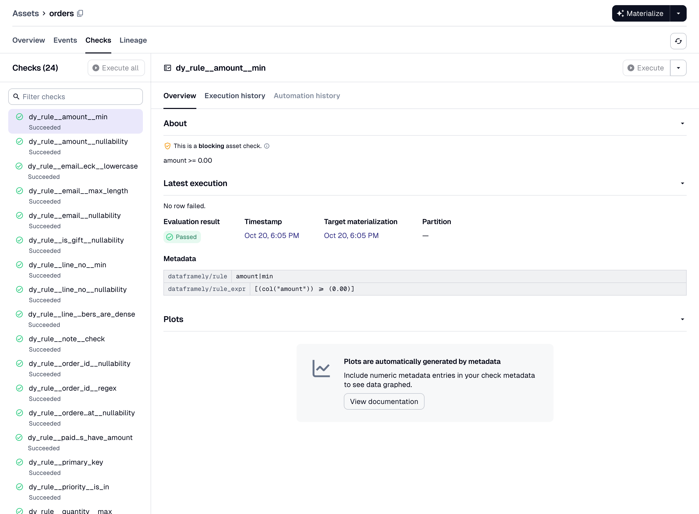

`dagster-dataframely` attaches a [Dataframely](https://github.com/Quantco/dataframely) schema to a [Dagster](https://dagster.io) asset whose function returns a [Polars](https://pola.rs) frame.
You declare the schema once, and `dd.asset` fills the Columns tab and reports each rule as an asset check.
Below, you declare one asset, see what `dd.asset` adds to it in Dagster, and run it.

<!-- snippet: demo/src/dagster_dataframely_demo/defs/silver/customers.py -->
```{python}
#| label: get-started-customers
import dataframely as dy
import polars as pl

import dagster_dataframely as dd


class CustomersSchema(dy.Schema):
    """A storefront customer account."""

    customer_id = dy.String(primary_key=True, description="Account identifier.")
    email = dy.String(nullable=False, description="Address for receipts.")
    lifetime_value = dy.Float64(nullable=False, min=0.0, description="Spend to date.")


@dd.asset(CustomersSchema)
def customers(raw_customers: pl.DataFrame) -> pl.DataFrame:
    """Validate the storefront's customer accounts."""
    return raw_customers
```

The asset's checks exist as soon as the module imports, one per rule plus the column-schema check.
By default, Dataframely adds a `nullability` rule to every column, and `inf` and `nan` rules to every float column:

```{python}
#| label: get-started-check-specs
[spec.name for spec in customers.check_specs]
```

The two Python modules on this page come from [the demo pipeline](https://github.com/ozanozbeker/dagster-dataframely/tree/main/demo), and every image is a screenshot of it.
The images show assets that use [`OrdersSchema`](https://ozanozbeker.com/dagster-dataframely/reference/data.OrdersSchema.html), the schema the package ships in `dd.data` for its examples.
From the `dd.asset` declaration above, you get:

- **The catalog's Columns tab**, filled in before the asset first runs: dtypes, descriptions, nullability, uniqueness, the primary key at table level, and every other column constraint beside its column.

  

- **One asset check per Dataframely rule**, and each check has its own pass/fail history.

  

- **A blocking column-schema check** that compares the frame's columns and dtypes with the schema's, before `Schema.filter` runs.

  

- **A severity for each rule**, `"error"` by default or `"warn"`, declared in the schema.
  A row that fails an `"error"` rule fails the run, and a row that fails only `"warn"` rules is written with a warning.

- **A code version derived from the schema**, so Dagster marks the asset stale after a schema edit.

- **Error rows**, if you set `filter=True`.
  A run writes the rows that failed an `"error"` rule to a table next to the asset's, writes the other rows to the asset's table, and succeeds.
  The run still fails when every row fails an `"error"` rule.

  

The decorated function is a normal Dagster asset function.
Dagster passes upstream assets to it as parameters.
It can also declare a `context` parameter.
It returns a `pl.DataFrame` or a `pl.LazyFrame`, a `dg.MaterializeResult` whose `value` is one of those, or `None`.

`dd.asset` accepts every `@dg.asset` parameter under the same name, except six that [Declaring an asset](declaring-an-asset.qmd) lists.

## Package philosophy

**Schema on write.**
`dd.asset` validates the frame before the asset writes it, never a table the asset reads.
The checks run before the IO manager receives the frame, so the IO manager never writes a row that failed an `"error"` rule.

Use this package after ingestion, from bronze to silver to gold, to check that data is fit to publish.
Load raw records with a permissive loader such as [`dlt`](https://dlthub.com), and declare a schema on the first table that other people query.
Use another tool for ingestion-scale or larger-than-memory data.

**The decorated function must return every column of the schema, with the schema's dtype.**
A missing column or a dtype that differs from the schema's fails the run, and the package never casts.
There is no lenient mode.
Extra columns and column order need no extra work: `Schema.filter` drops the columns the schema does not declare and returns the rest in the schema's order.

**Partial data needs a declaration, not a setting.**
The only parameter for it is `filter=True`.
No environment variable sets it.
Without it, one row that fails an `"error"` rule fails the run and the package writes nothing, so your last-known-good table is unchanged.

**The decorator is strict, but you can use its parts without it.**
The package builds `dd.asset` from parts that it also exports under `dd.wiring`.
Use them for an asset that `dd.asset` cannot build, such as one that writes its own storage, as [Hand-wiring](hand-wiring.qmd) shows.
For a table that something else already wrote, `dd.build_rule_checks` reports the schema's rules as asset checks, as [Rule checks](rule-checks.qmd) shows.

## Running the asset

To run `customers`, [install the package](https://ozanozbeker.com/dagster-dataframely/#installation), bind an IO manager, and materialize the asset from the Dagster UI.
In a `dg` project, Dagster loads every module under `defs/` automatically, so the IO manager needs one more file:

<!-- snippet: demo/src/dagster_dataframely_demo/defs/resources.py -->
```{python}
#| label: get-started-resources
import dagster as dg

from dagster_dataframely.data import ParquetIOManager


@dg.definitions
def resources() -> dg.Definitions:
    """Bind the Parquet IO manager the pipeline writes through."""
    return dg.Definitions(
        resources={"io_manager": ParquetIOManager(base_dir="storage")}
    )
```

The package ships `ParquetIOManager` for its examples, so they need no IO manager library.
In your own project, bind a library IO manager such as [`dagster-polars`](https://docs.dagster.io/integrations/libraries/polars)' `PolarsParquetIOManager`.

`customers` reads `raw_customers`, so the asset that produces `raw_customers` goes under `defs/` too.
Run `dg dev` and materialize both from the UI.

After the run, the asset has four things:

- The catalog's Columns tab, filled from `CustomersSchema`, before the first run.
- One asset check per rule, each with its own history.
- A materialization that has the row count, a row sample and statistics for each dtype group.
- A table, written by your IO manager.

To write the rows that fail an `"error"` rule to a separate table instead of failing the run, declare `@dd.asset(CustomersSchema, filter=True)`, as [Filtering error rows](filtering-error-rows.qmd) describes.

## Where to go next

Read the Guide pages in order:

1. [Declaring an asset](declaring-an-asset.qmd) covers the decorator's parameters, the code version and what the function may return.
2. [Validation](validation.qmd) lists the five kinds of run and what each one writes.
3. [Rule severity](rule-severity.qmd) covers declaring a `"warn"` rule and which checks are blocking.
4. [Filtering error rows](filtering-error-rows.qmd) covers `filter=True` and the error rows.
5. [What a run produces](what-a-run-produces.qmd) lists every metadata key a run writes.
6. [Testing an asset](testing-an-asset.qmd) covers testing an asset by calling it, with no run.
7. [Partitioning](partitioning.qmd) covers an asset with a `partitions_def`.
8. [`LazyFrame`s](lazyframes.qmd) covers a `pl.LazyFrame` that the asset reads or returns.
9. [Collection checks](collection-checks.qmd) covers `dd.build_collection_checks`, which reports a Dataframely `Collection`'s collection filters as asset checks.
10. [Rule checks](rule-checks.qmd) covers `dd.build_rule_checks`, which reports a schema's rules as asset checks on an asset that `dd.asset` did not build.

The Details pages are for looking something up: [Settings](settings.qmd), [Naming](naming.qmd), [Errors](errors.qmd), [Hand-wiring](hand-wiring.qmd) and [Upgrading](upgrading.qmd).
