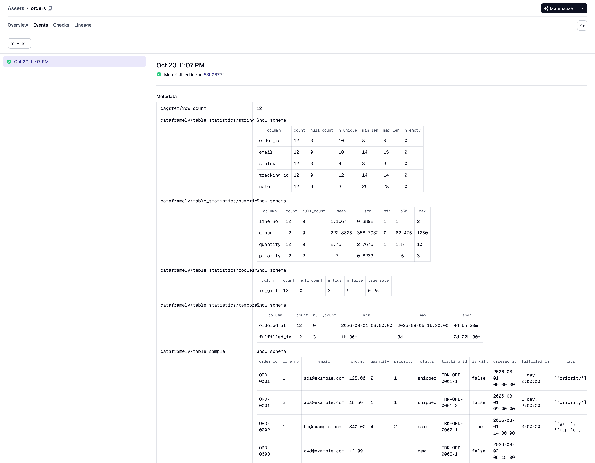

```{python}
#| label: setup-what-a-run-produces
#| code-fold: true
#| code-summary: "Setup: the imports every example on this page uses"
#| output: false
import dagster as dg
import polars as pl

import dagster_dataframely as dd
from dagster_dataframely.data import OrdersSchema
```

This package reports a run's results in two places: the table's materialization and the asset checks.
You add your own metadata to the same materialization by returning a `dg.MaterializeResult`.

## The table's materialization

The row count is under one of Dagster's own keys: `dagster/partition_row_count` on a partitioned asset, and `dagster/row_count` otherwise.
The column schema is under Dagster's `dagster/column_schema`.
Every other key this package writes is in the `dataframely/` namespace, as Dagster's own keys are in `dagster/`.

| key | what it holds |
| --- | --- |
| `dagster/row_count` | how many rows the run wrote to the table, not how many the function returned |
| `dagster/partition_row_count` | the same count on a partitioned asset, in place of `dagster/row_count` |
| `dagster/column_schema` | the schema's columns, with their dtypes, constraints, descriptions and tags |
| `dataframely/table_sample` | the first `row_sample` rows of the table |
| `dataframely/table_statistics/<group>` | one table per dtype group present |
| `dataframely/error_rows_address` | where the writer wrote the error rows |
| `dataframely/error_rows_count` | how many rows failed at least one `"error"` rule |
| `dataframely/error_rows_sample` | the first `row_sample` error rows, with their rule columns |
| `dataframely/error_rows_by_rules` | how many rows failed each set of rules together, highest count first |

The last four appear only on a run with `filter=True` where some rows failed an `"error"` rule.
`dataframely/error_rows_by_rules` counts each error row once, under the set of rules it failed.
So one bad upstream field that fails three rules appears as one count, not as three unrelated counts.
It names rules as the error rows' rule columns do, so its names match the check names only at `rule` granularity.


Every value that contains rows is a Dagster table value.
The two counts are integers, and the error-rows address is a string.



The Columns tab shows the schema from the asset definition before the first run.
After a run, it shows the `dagster/column_schema` on the latest materialization, with the descriptions and tags from the definition.
That entry replaces any column schema your IO manager writes.
For example, `PolarsParquetIOManager` writes one from the frame, with no constraints.
So after you edit the schema, the tab shows the new descriptions and tags at once, and the new dtypes, nullability and constraints after the next run.

## The statistics tables

There is one table for each dtype group present in the written rows.
Each table has one row per column, in the frame's column order.
A column whose dtype is in no dtype group, such as a `List`, `Struct` or `Array`, appears in no table, because only a count and a null count would apply to it.

| group | dtypes | columns |
| --- | --- | --- |
| `numeric` | `Int*`, `UInt*`, `Float*`, `Decimal` | `count`, `null_count`, `mean`, `std`, `min`, `p50`, `max` |
| `temporal` | `Date`, `Datetime`, `Time`, `Duration` | `count`, `null_count`, `min`, `max`, `span` |
| `string` | `String`, `Categorical`, `Enum`, `Binary` | `count`, `null_count`, `n_unique`, `min_len`, `max_len`, `n_empty` |
| `boolean` | `Boolean` | `count`, `null_count`, `n_true`, `n_false`, `true_rate` |

The package computes `mean`, `std`, `p50` and `true_rate`, so it rounds them to four decimal places.
`min` and `max` are values from the data, so the table shows them exactly.
The one exception is a `Decimal`: the table shows it as a float, so it rounds any value with more digits than a float holds.

Lengths are in bytes, the unit of Dataframely's `max_length` on a `String`, so this table matches the column constraints.
The table shows a `span` in Polars' own duration form, such as `8d` or `1m 30s`, not ISO-8601.
A `Duration` column's `min` and `max` use the same form.

**The string group has no statistic that shows values from the data**, at any setting.
A `min` or `max` on an email column would write real addresses into the event log, which a deployment shares, anyone can export, and nothing deletes.
Lengths and cardinality detect the same problems.
The row sample and the failure examples do contain real rows.
[Settings](settings.qmd#statistics-the-row-sample-and-the-failure-examples-are-on-by-default) shows how to turn them off.

The package computes no statistics for the error rows.

## The checks

The column-schema check reports first and is blocking.
Each rule set then has one check.

| check metadata | on which check |
| --- | --- |
| `dataframely/rule`, `dataframely/rule_expr` | a check reporting for one rule |
| `dataframely/failed_row_count` | a check reporting for one rule, when any row failed |
| `dataframely/failed_examples` | a check reporting for one rule or a collapsed check, when any row failed |
| `dataframely/rules` | a collapsed check: a row per rule with its failure count and expression |
| `dataframely/column_schema_errors` | the column-schema check, when it fails: a row per mismatched column |

In a collapsed check, each row of `dataframely/failed_examples` has a `dy_rule` column with the rule that row failed.
A collapsed check has no total failure count.
Counts are per rule, and one row can fail several rules, so their sum is not a row count.

`max_failure_examples` applies per rule, not per check.
So in a collapsed check, a rule that a thousand rows failed cannot fill the examples and leave out a rule that one row failed.

A run that raises `NoValidRowsError` yields no materialization for the table, so the package copies `dataframely/error_rows_address` onto every check result instead.

Each check result also has a description, which the Checks tab shows on each evaluation row.
It repeats the counts and names in the result's metadata.

| check | failed | passed |
| --- | --- | --- |
| a check reporting for one rule | `3 rows failed.` | `No row failed.` |
| a collapsed check | `2 rules failed: amount|nullability (1 row), amount|min (3 rows).` | `No rule failed.` |
| the column-schema check | `2 columns do not match: amount, status.` | `Every column matches.` |

A collapsed check names only the rules that failed.

## Attaching your own metadata

Use the context to read the run.
Use the return value to write the materialization.

**Return a `dg.MaterializeResult` with the frame as its `value`.**
`@dg.asset` accepts the same return value.
It is the only supported way to set a materialization's tags and data version.
It also works under direct invocation, as [Testing an asset](testing-an-asset.qmd) shows.

```{python}
#| label: what-a-run-produces-1
@dd.asset(OrdersSchema)
def orders(raw_orders: pl.DataFrame) -> dg.MaterializeResult[pl.DataFrame]:
    return dg.MaterializeResult(
        value=raw_orders,
        metadata={"source": "stripe", "extracted_at": "2026-08-13"},
        data_version=dg.DataVersion("2026-08-13"),
        tags={"run/flavour": "backfill"},
    )
```

`value` is the frame to validate, and you have to set it.
The package copies `metadata`, `data_version` and `tags` onto the table's materialization.
The error rows' materialization has none of them.

Setting the result's `asset_key` or `check_results` raises `MaterializeResultFieldError`, which names the field.
The decorator sets the asset key from its declaration and the check results from the schema's rules.

**This package's own metadata keys take precedence.**
If you return a key the package also writes on that run, such as `dataframely/table_sample` or the row-count key, the package's value replaces yours.
On a partitioned asset, the row-count key is `dagster/partition_row_count`, so the package copies a returned `dagster/row_count` unchanged.
The schema's `dagster/column_schema` replaces a returned one too.
The package copies every other key you return onto the materialization unchanged.


### Using the context

`context.add_asset_metadata` is the other way to attach metadata, and older Dagster examples use it.
It raises `AttributeError` under direct invocation, as `set_data_version` does.
The decorator builds one asset with one key, so the call works without an `asset_key`:

```{python}
#| label: what-a-run-produces-2
@dd.asset(OrdersSchema)
def orders(context: dg.AssetExecutionContext, raw_orders: pl.DataFrame) -> pl.DataFrame:
    context.add_asset_metadata({"source": "stripe"})
    return raw_orders
```

**It overrides this package's own keys, unlike a returned result.**
Dagster merges the context's metadata last, after the package yields its results.
So `context.add_asset_metadata({"dagster/row_count": 999})` shows 999 in the catalog for a table with two rows.
The package cannot prevent this.
The one exception is `dagster/column_schema`.
The package writes it with `add_asset_metadata` after your function returns, so the schema's column schema replaces yours.

**This package does not support `context.set_data_version`.**
It is not marked `@public` in Dagster, and it does not work under direct invocation.
Set `data_version=` on a returned `dg.MaterializeResult` instead, which sets the same event tags.

Avoid `context.add_output_metadata`.
Every asset check is an output, and this package always declares the column-schema check.
So an asset built with `dd.asset` always has several outputs, and the call raises:

```text
DagsterInvariantViolationError: Attempted to add metadata without providing output_name, but multiple outputs exist. Please provide an output_name to the invocation of `context.add_output_metadata`.
```

Naming the output works: Dagster names the asset's output `result`, whatever you call the asset and under every `key_prefix`.
That name is internal to Dagster, and the catalog never shows it.
Return a `dg.MaterializeResult` instead.

::: {.callout-note}
This page documents only `add_asset_metadata`, `set_data_version` and `add_output_metadata` on Dagster's context.
This package guarantees nothing about the rest of the context, in this or any future Dagster version.
If you find another method that works and is worth documenting, [open an issue](https://github.com/ozanozbeker/dagster-dataframely/issues).
:::
